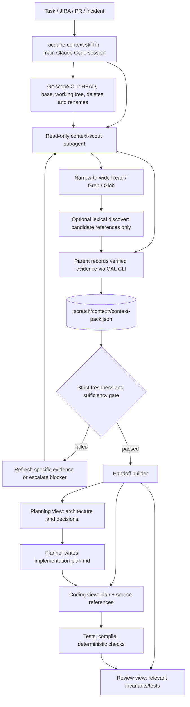
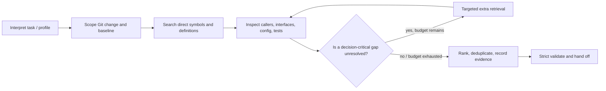
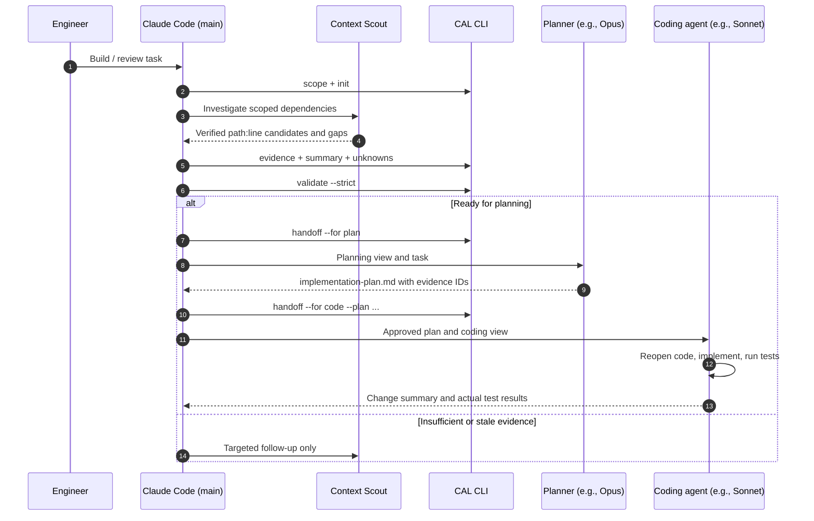
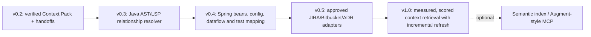

# Context Acquisition Layer (CAL) — Claude Code Plugin

> **v0.2.0 — first usable MVP** · Evidence-first context for planning, coding, debugging and review · Node.js 20+ · No third-party runtime dependencies.

CAL helps Claude Code **find and preserve the *right* repository evidence**, rather than handing a planner or coding agent an unbounded file dump. It supports a task-aware scout, repeatable Git scope detection, bounded lexical candidate discovery, source fingerprints, a persisted Context Pack, a strict readiness gate, and separate planning/coding/review handoffs.

**Important:** This is *not* an Augment-style semantic engine, a Java call graph, or an autonomous reviewer. It is an engineered acquisition and handoff workflow built on Claude Code's native tools. It cannot independently determine whether an evidence claim is semantically correct. Use it for non-sensitive repositories until your organization's approval and evaluation are complete.

## Quick start

Unzip the package. You can load its directory or the ZIP itself using a supported Claude Code version:

```bash
# Terminal — run this from the actual Git repo you want to analyze
claude plugin validate /path/to/context-acquisition-plugin
claude --plugin-dir /path/to/context-acquisition-plugin
```

Inside Claude Code:

```text
/context-acquisition:acquire-context
Profile: build
Task: Add freshness validation to the existing rate sourcing flow.
Identify producer/consumer paths, config, existing validations,
related tests and any unresolved policy decisions. Do not change source.
```

The main agent will coordinate an evidence-only scout and save the resulting pack under `.scratch/context/<task-id>/context-pack.json`. It should call the CLI for every source citation so hashes are computed automatically, run `validate --strict`, then write a focused handoff.

**Before first use**, add `.scratch/` to the target repository's `.gitignore`, or configure an equivalent organization-approved local ignore rule. CAL intentionally does not edit your `.gitignore` or source repository configuration. The pack lives in the *target repository*, not the plugin's installation directory.

### Offline smoke test without Claude Code

From any Git repo containing code you are allowed to inspect:

```bash
CAL="/absolute/path/to/context-acquisition-plugin/scripts/cal.mjs"
node "$CAL" scope
node "$CAL" init --id sample-review --task "Investigate the validation flow" --profile build
node "$CAL" discover --file src/RateService.java --max 20
# After inspecting actual source, record the correct lines/behavior:
node "$CAL" evidence --pack .scratch/context/sample-review/context-pack.json \
  --file src/RateService.java --start 18 --end 25 --role definition \
  --claim "RateService delegates validation to an existing helper" \
  --why "Locates the change boundary"
node "$CAL" summary --pack .scratch/context/sample-review/context-pack.json \
  --text "The task touches rate validation and its existing helper path."
node "$CAL" validate --pack .scratch/context/sample-review/context-pack.json --strict
node "$CAL" handoff --pack .scratch/context/sample-review/context-pack.json --for plan --write
```

Replace the sample path, range and claim with real evidence before executing `evidence`; none of the example source files are assumed to exist. You can run `node "$CAL" help` for every CLI command.

## 1. Why this layer exists

Normal Claude Code can search a repository. CAL is intended to help when that exploration would otherwise be **repeated**, **under-scoped**, or **forgotten across agent handoffs**.

| Engineering problem | CAL's response |
| --- | --- |
| Planning, coding and review each repeat code searches | One canonical pack, multiple focused views |
| Agent reads a changed method but misses a related module | Explicit changed-file scope and bounded reference discovery |
| Decisions rest on unchecked statements | Record each fact with file, line range and fingerprint |
| Agent proceeds despite missing business policy | Critical-blocker gate stops handoff |
| Code changes after research | Recheck HEAD, Git working-tree scope and exact evidence lines |
| Main context fills with exploratory output | Read-only `context-scout` returns compact source citations |

For small and localized edits, *skip CAL*. The separate acquisition step has model and latency cost; compare it with native Claude Code before making it mandatory.

## 2. Architecture



**Separation of responsibility:** the scout searches; the CLI checks paths/hashes and persists; the planner decides; the coding agent edits; verification establishes whether the implementation works. The CLI does not create source claims on its own.

### Internal acquisition algorithm



**Default search budget:** up to three retrieval rounds, approximately 12 high-value evidence entries, 15 relevant files, and 25 candidate references per lexical search. These are guidelines in the skill, not hard token quotas; CLI caps evidence at 50 and candidate results at 100. Stop when additional searching is unlikely to change the next decision; disclose material gaps.

## 3. The Context Pack contract

`schemaVersion: 1.1` is the v0.2 format. An example file is at `examples/context-pack.example.json` (illustrative placeholders; **not** valid evidence).

```json
{
  "schemaVersion": "1.1",
  "id": "rate-freshness",
  "task": "Add rate freshness validation",
  "profile": "build",
  "state": "draft",
  "createdAt": "2026-11-08T00:00:00.000Z",
  "repoHead": "<actual-git-sha>",
  "base": null,
  "scopeFingerprint": "<derived-by-init>",
  "scopeDirty": false,
  "changedFiles": [
    { "path": "src/RateService.java", "status": "M", "source": "working", "sources": ["working"] }
  ],
  "summary": "Verified summary from source inspection",
  "relevantFiles": [
    { "path": "src/RateService.java", "role": "definition", "why": "Validation boundary" }
  ],
  "evidence": [
    {
      "id": "E1",
      "claim": "A verified observation about the source",
      "path": "src/RateService.java",
      "startLine": 18,
      "endLine": 25,
      "snippetSha256": "<generated-by-evidence-command>",
      "role": "definition",
      "why": "Relevant to the decision"
    }
  ],
  "relationships": [
    { "from": "src/Caller.java", "to": "src/RateService.java", "kind": "calls", "evidenceIds": ["E1"], "verification": "user-or-agent-asserted" }
  ],
  "unknowns": ["Non-blocking gap"],
  "blockers": [],
  "retrieval": { "queries": ["rate validation callers"], "limitations": [], "stopReason": "Enough evidence for planning" }
}
```

The above is a **shape illustration**: references, statuses and hashes must be sourced from the real repository. The `relations` record is not inherently validated as true: its evidence IDs must exist, but human/agent reasoning must verify the edge. No full source snippets or secrets are embedded in the pack.

### Readiness gate

`cal.mjs validate --pack <pack> --strict` fails on:

- Missing summary, evidence, or relevant source files.
- Missing, unsafe or stale evidence paths/line hashes.
- A different Git HEAD or changed scope fingerprint.
- Unresolved `blockers` or relationships citing nonexistent evidence IDs.

A regular `validate` checks structural and source-reference validity but permits a draft pack without evidence; **strict validation is required for handoff**. A passing gate does not prove the factual correctness of claims or that all dependencies were found.

### How does freshness work?

For every recorded source range, CAL hashes the exact lines using SHA-256. It also records the repository HEAD and a Git working-tree status/numstat fingerprint. Strict validation detects changed evidence and changes in these coarse scope markers. It cannot detect every semantic change outside captured lines or all untracked-file content modifications. Reopen relevant source just before editing.

## 4. Planner → coder sequence



**Planner receives:** objective, file map, verified facts, relationships, constraints and unknowns. The planner proposes options, chosen approach, acceptance criteria, test strategy and unresolved decisions; it cites `E1`, `E2`, etc. A blocker cannot be silently assumed away.

**Coder receives:** the approved implementation plan plus a **fresh** coding view of the pack, relevant interfaces, tests and evidence IDs. The coder must reopen current source before editing, record deviations from the plan and run appropriate checks. If the working tree changed after the pack was built, reacquire only the necessary evidence and revalidate.

A coding handoff **requires** `--plan path/to/implementation-plan.md`; the CLI confirms that the file exists but does not independently judge plan quality or approval.

## 5. CLI reference (run from target Git repository)

| Command | Purpose |
| --- | --- |
| `scope [--base <git-ref>]` | Git HEAD, committed change range, working and untracked files (including deletion/renames) |
| `init --id --task --profile [--base]` | Create new draft `.scratch/context/<id>/context-pack.json`; never overwrite |
| `discover --file <path> [--symbol X] [--max 25]` | Find limited lexical **reference candidates**, not call edges |
| `evidence --pack --file --start --end --role --claim --why` | Verify source and add line-fingerprinted observation |
| `relation --pack --from --to --kind --evidence E1,E2` | Add asserted relationship with existing evidence references |
| `summary --pack --text` | Add a concise source-backed summary |
| `unknown --pack --text [--severity blocker]` | Record unresolved gap, optionally halt handoff |
| `resolve --pack --text` | Remove an exact recorded question (record its resolution evidence separately) |
| `retrieval --pack --query [--stop-reason]` | Log meaningful searches and stopping reason |
| `validate --pack [--strict]` | Validate structure, paths, freshness, blockers |
| `handoff --pack --for plan|code|review [--plan] [--write]` | Return Markdown view; `--write` stores alongside pack |

CLI supports profiles `build`, `review`, `debug`, `architecture`. Evidence roles include `changed`, `definition`, `caller`, `callee`, `implementation`, `contract`, `config`, `test`, `invariant`, `documentation`, `other`.

### Manual example of additional commands

```bash
node "$CAL" discover --file src/RateValidator.java
node "$CAL" unknown --pack .scratch/context/sample-review/context-pack.json \
  --severity blocker --text "What is the approved fallback when rates are stale?"
# Confirm the correct answer with a trusted requirement and cite its source,
# then resolve and revalidate:
node "$CAL" resolve --pack .scratch/context/sample-review/context-pack.json \
  --text "What is the approved fallback when rates are stale?"
node "$CAL" validate --pack .scratch/context/sample-review/context-pack.json --strict
```

### Explicit code handoff

```bash
# A human or planning agent has written the approved/accepted plan here:
PLAN=.scratch/context/sample-review/implementation-plan.md
node "$CAL" handoff --pack .scratch/context/sample-review/context-pack.json \
  --for code --plan "$PLAN" --write
# Produces .scratch/context/sample-review/code-context.md
```

## 6. Plugin contents

```text
context-acquisition-plugin/
├── .claude-plugin/plugin.json
├── skills/
│   ├── acquire-context/SKILL.md       # Parent coordinator, persists pack
│   └── handoff-context/SKILL.md       # Strict gate + target-specific handoff
├── agents/context-scout.md            # Read/Grep/Glob only
├── lib/cal-core.mjs                  # Git, paths, pack format, evidence checks
├── scripts/
│   ├── cal.mjs                       # Primary CLI
│   ├── changed-files.mjs             # Compatibility wrapper
│   ├── validate-pack.mjs             # Compatibility wrapper
│   └── linehash.mjs                  # Independent fingerprint utility
├── examples/context-pack.example.json
├── docs/
│   ├── INTEGRATION.md                # Model Flow / CLAUDE.md integration
│   ├── EVALUATION.md                 # A/B tests and rubric
│   └── IMPLEMENTATION-PLAN-TEMPLATE.md # Evidence-citing plan outline
├── tests/cal.test.mjs
├── package.json
└── README.md
```

The acquisition skill is deliberately **not** a `context: fork` skill, since it has to orchestrate persistence in the main session. `context-scout` is a separate read-only subagent. Its `tools` allowlist excludes Bash, editing, and MCP access. If enterprise policy prohibits subagents, the parent can use approved read-only native tools and still use the pack CLI.

## 7. Security and limitations

- No npm install, network requests, background indexing, or automatic MCP connections. All code runs locally through Node and Git.
- The CLI checks for path traversal, symlinks and common sensitive filenames; source evidence is limited to allowed text extensions and 2 MB per file. **It is not a DLP system**. Keep credentials and sensitive repository material out of context.
- The Git/ref retrieval functions run read-only git subcommands through `execFileSync` (no shell interpolation). The CLI only writes beneath `.scratch/context/<id>`.
- Other users or tools could modify files after verification (time-of-check/time-of-use). Fingerprints reduce stale evidence; they cannot prevent a concurrent change.
- `discover` uses tracked Git text only; it is lexical, can return irrelevant matches and can miss reflective calls, dependency injection, dynamic dispatch, and dependencies in untracked files.
- The skills rely on Claude correctly choosing and invoking them. We provide instructions and deterministic checks, **not** an autonomous enforcement hook that intercepts every planning/coding action.
- Do not use this plugin to bypass enterprise restrictions. Any future JIRA, Bitbucket or semantic MCP provider requires approval, scoped permissions and data-handling review.
- For a new repository, `git rev-parse HEAD` must succeed; initial commit first. Base refs are explicit and not auto-assumed.

## 8. Quality evaluation

Start with 5–10 representative code changes (and expand to 15–20). Compare **native Claude Code Explore** vs **Claude Code + CAL** with the same task instructions, model, allowed tools and revision. For each case record:

| Metric | Measurement |
| --- | --- |
| Critical dependency recall | Discovered ground-truth relevant code paths ÷ all required paths |
| False relationships | Claimed caller/config edge unsupported by source |
| Correctness | Tests and independent acceptance criteria after implementation |
| Retrieval cost | End-to-end tokens/cost, including scout calls |
| Latency | Total wall-clock to finished, reviewed output |
| Evidence integrity | Stale/incorrect file:line citations and blocked handoffs |

Targets are hypotheses, not established performance claims. A useful MVP should show fewer missed dependencies or less duplicated exploration **without unacceptable latency or cost**. See `docs/EVALUATION.md` for a reusable scorecard.

## 9. Roadmap



- **v0.3:** Use JavaParser/JDT/LSP to verify type- and method-level references; rank by module distance and task role.
- **v0.4:** Resolve Spring bean wiring, XML/config dependency paths, API contracts and related test coverage; add domain-invariant context.
- **v0.5:** Add optional organization-approved ticket and documentation providers with provenance and source access boundaries.
- **v1.0:** Retrieval relevance feedback, incremental evidence invalidation, regression evaluation, query/cost budgets, and CI entry points.
- **Optional later:** Private semantic search, code graph, cross-repository indexing, context history. Only pursue after measured benefit over deterministic discovery.

## 10. Verification and official references

```bash
cd /path/to/context-acquisition-plugin
node --test tests/cal.test.mjs
node --check scripts/cal.mjs
claude plugin validate .                 # Requires Claude Code installed
```

Docs reviewed while designing this plugin:

- [Claude Code — Create a plugin](https://code.claude.com/docs/en/plugins/create)
- [Claude Code — Skills](https://code.claude.com/docs/en/skills)
- [Claude Code — Subagents](https://code.claude.com/docs/en/sub-agents)
- [Claude Code — Plugin components](https://code.claude.com/docs/en/plugins/components)

**Status:** CAL CLI and local tests can be verified offline. Live Claude Code plugin loading, actual model delegation, and end-to-end quality uplift have **not** been tested in this package's build environment.
