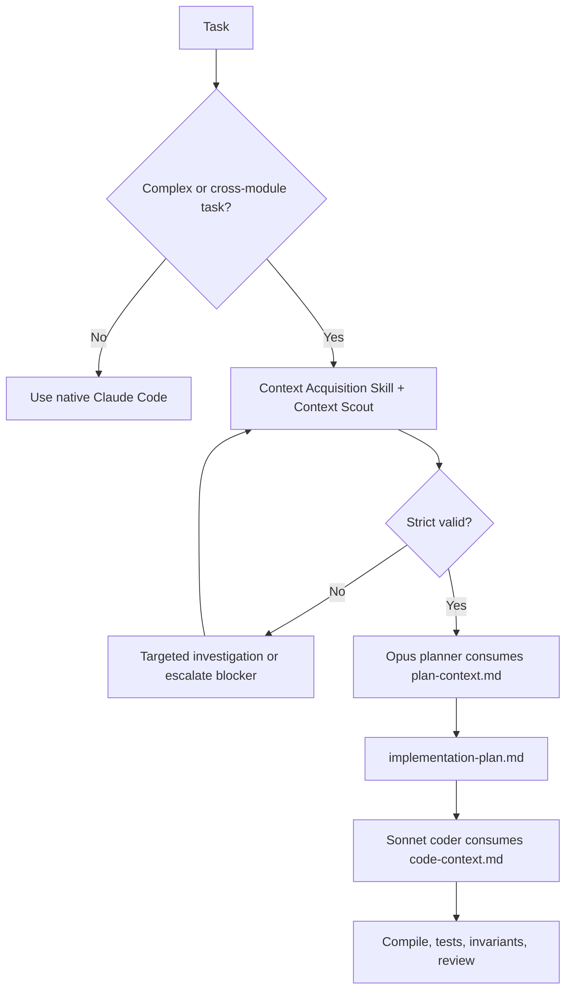

# Integrating CAL with Model Flow and Claude Code

This is an **optional, manual handoff integration**. Do not assume an existing Model Flow plugin's command names or file layout. Update that plugin only after confirming its actual structure.

## Recommended orchestration



## Suggested workflow guidance (copy selectively to your own workflow skill)

```markdown
## Evidence-first work handoff
For substantial implementation, architectural changes, cross-module debugging, or deep PR review:
1. Invoke the context-acquisition skill (or delegate to its context-scout and CAL CLI).
2. Build the task-scoped Context Pack in `.scratch/context/<id>/context-pack.json`.
3. Run `validate --strict`; stop when blockers or stale evidence remain.
4. The planning agent consumes `plan-context.md` and writes `implementation-plan.md` citing evidence IDs.
5. The coding agent consumes the approved implementation plan plus `code-context.md`; it reopens target source.
6. The verifier runs tests and checks invariants, logging actual results, not inferred success.
Skip the CAL gate for trivial changes, and refresh only invalidated evidence after edits.
```

## Handoff files

- `context-pack.json`: canonical machine-readable acquisition evidence.
- `plan-context.md`: generated planning view; no architecture decisions made by CAL.
- `implementation-plan.md`: external planner-generated artifact; CLI checks that it exists for code handoff but does not generate or approve it.
- `code-context.md`: generated coding view; includes the plan reference and source evidence.
- `review-context.md`: generated review view.

## Shared code across multiple agents

A Context Pack is only as good as its citations. Keep pack content compact; when agent reasoning identifies a new dependency, append new evidence and regenerate the target view. Do not automatically re-run whole-repo search between stages.

## Typical upgrade candidates

1. Java LSP/JDT/JavaParser to verify referenced symbols.
2. Spring bean and config analysis for runtime wiring.
3. Approved JIRA and Bitbucket adapters for business context.
4. Incremental invalidation and CI evaluation.

Avoid a mandatory background MCP process or repository-wide index until A/B evaluation demonstrates a clear need.
